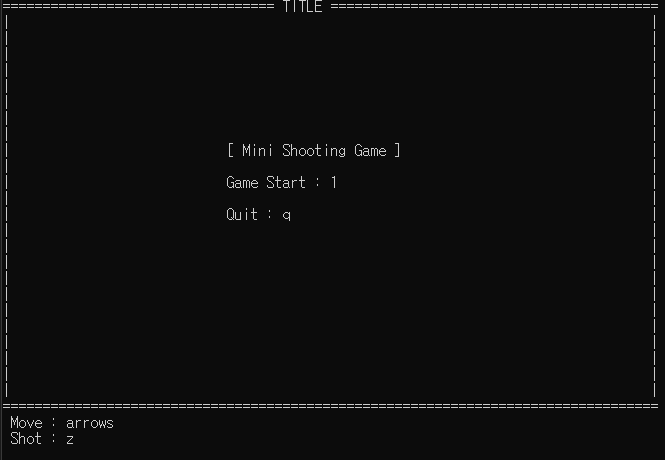

# [미니프로젝트] 절차지향 콘솔 슈팅게임
* 게임루프와 절차지향 함수형 프로그래밍 기본 구조를 학습하기 위한 미니프로젝트
* 소스파일 분리, Input, Logic, Render 파트 분리하여 메인루프 구성
* Scene 개념 구현. TitleScene, LoadScene, GameScene
* stage.txt enemy.txt 등 활용하여 파일로부터 스테이지 정보, 적 정보 로딩하여 레벨디자인 기획 가능하도록 구현

# 플레이 이미지

