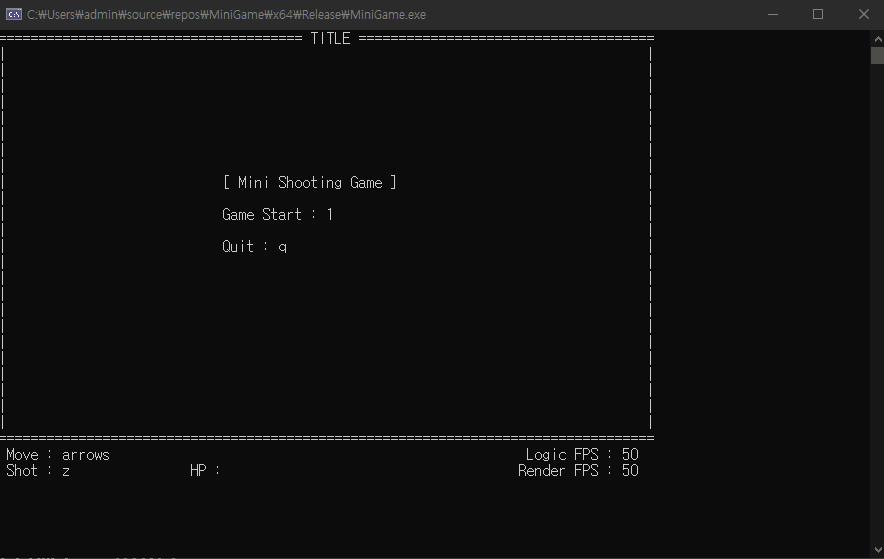

# [미니프로젝트] 절차지향 콘솔 슈팅게임
* 게임루프와 절차지향 함수형 프로그래밍 기본 구조를 학습하기 위한 미니프로젝트
* Scene 개념 구현. TitleScene, LoadScene, GameScene
* stage.txt enemy.txt 등 활용하여 파일로부터 스테이지 정보, 적 정보 로딩하여 레벨디자인 기획 가능하도록 구현
* FPS 제어 및 RenderSkip 구현하여 부하가 심할 때 렌더링을 포기하며 LogicFPS 보장하도록 구현

<br>

# 플레이 이미지


<br>

# stage.txt
```text
--------------------------------------------------------------------------------
--------------------------------------------------------------------------------
--------------------------------------------------------------------------------
------------------------------1-------------------------------------------------
------------------------------------------------1-------------------------------
-----------------1--------------------------------------------------------------
--------------------------------------------------------------------------------
--------------------------------------------------------------------------------
--------------------------------------------------------------------------------
-----------------------------------------------------------1--------------------
--------------------------------------------------------------------------------
--------------------------------------------------------------------------------
--------------------------------------------------------------------------------
--------------------------------------------------------------------------------
--------------------------------------------------------------------------------
--------------------------------------------------------------------------------
--------------------------------------------------------------------------------
--------------------------------------------------------------------------------
--------------------------------------------------------------------------------
--------------------------------------------------------------------------------
--------------------------------------------------------------------------------
--------------------------------------------------------------------------------
--------------------------------------------------------------------------------
--------------------------------------------------------------------------------
```

# enemy.txt
```text
shotType=1
hp=3
attack=1
moveSpeed=10
bulletSpeed=10
shotCooldown=1
movePattern=2
```

# movePattern.txt
```text
LLLLRRRRRRRRLLLL
```
